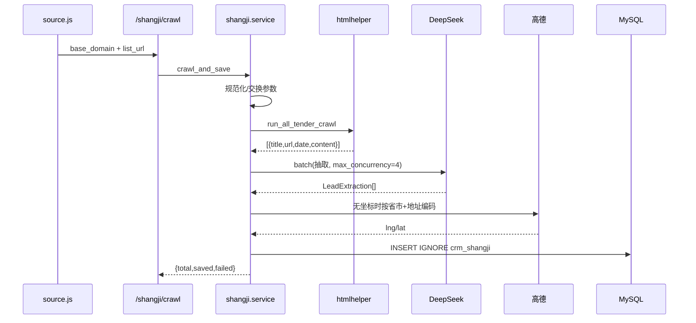
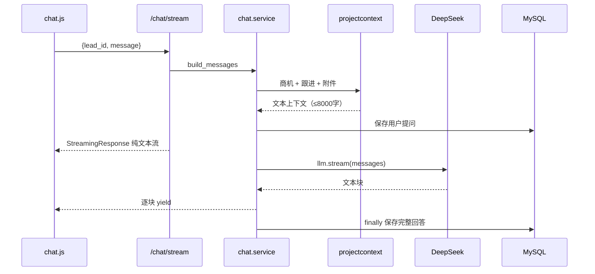

# CRM 商机系统 · 实现逻辑说明

## 1. 启动与请求链路

```text
浏览器
  → Uvicorn
  → com.crm.main:app
  → SessionMiddleware（解析/签名 session）
  → 子路由（/user、/shangji、/source、/followup、/attachment、/owner、/chat、/summary）
  → Service 业务层
  → DAO / Helper
  → MySQL / 高德 API / DeepSeek
```

启动命令：

```bash
cd D:/workspace-pycharm/aicrm
.venv/Scripts/python.exe -m uvicorn com.crm.main:app --host 127.0.0.1 --port 8000 --reload
```

`main.py` 做的事：

1. 加载 `.env`。
2. 安装 `SessionMiddleware`（`request.session` 的前提）。
3. 注册全部业务路由。
4. 挂载 `/static`。
5. 注册统一异常处理：HTTP 200 + `body.code`。
6. 提供 `/login`、`/register`、`/` 三个页面路由。

---

## 2. 登录 / 注册

### 注册

```text
POST /user/register
{ "username": "...", "password": "...", "nickname": "..." }
```

- `user/service.register`
  - 校验用户名唯一；
  - `dao.count() == 0` 时首个用户为 `admin`，其余为 `user`；
  - PBKDF2-HMAC-SHA256 加盐哈希后入库。

### 登录

```text
POST /user/login
→ 校验密码和 status
→ session 写入 uid/username/role
→ 返回用户公开信息
```

- 密码校验使用 `hmac.compare_digest`（常量时间比较）。
- 前端登录成功后跳转 `/`。
- 页面路由未登录 302 到 `/login`；接口 `require_login` 抛 `BizException(code=401)`。

---

## 3. 商机采集

### 前端

`static/source/js/source.js`

1. 「商机采集」菜单 → 省 → 市。
2. 点击城市打开弹窗，读取已保存配置：
   ```text
   GET /source/get?province=安徽省&city=合肥市
   ```
3. 「保存」：
   ```text
   POST /source/save
   { province, city, base_domain, list_url }
   ```
4. 「执行」：先保存，再调用：
   ```text
   POST /shangji/crawl
   { base_domain, list_url }
   ```

`formValues()` 会：

- 去掉 `base_domain` 末尾 `/`；
- 校验两个 URL；
- 如果两个字段填反，自动交换并提示。

### 后端

`com/crm/shangji/service.py → crawl_and_save`



关键点：

- 爬虫选择器硬编码为合肥公共资源交易中心。
- 详情串行抓取，每条后休眠 2~10 秒。
- 正文截断到 6000 字再送模型。
- `batch(return_exceptions=True)` 保证单条失败不影响其他条，且结果顺序与输入一致。
- LLM 使用 `json_mode`（思考模式不支持强制 `tool_choice`）。
- 模型给出的非零坐标直接使用；否则调用高德地理编码，城市 → 省份 → 全国回退。
- `source_url_md5` 是唯一键，重复 URL 被 `INSERT IGNORE` 跳过，
  因此 `saved + failed` 可能小于 `total`。

---

## 4. 地图与页签

### 加载点位

```text
GET /shangji/points
```

- `shangji/dao.list_points` 只查经纬度非空的商机。
- `needs` / `objections` 从 JSON 还原为数组。
- `service.get_points` 补充 `project_name = source_title || customer || 未命名项目`。

### 地图交互

`static/shangji/js/map.js`

- 初始化高德地图，默认中心南京。
- 按意向等级给水滴着色：高=红、中=蓝、低=灰。
- 顶部筛选：行业、意向、区域（省份/市，前端过滤）。
- 点击水滴打开唯一复用的 `InfoWindow`，包含：

```text
概况 | 商机 | 负责人 | 跟进 | 招投标 | 立项 | 总结
```

- 「概况」为默认页签，因此 `map.js` 在打开 InfoWindow 后显式调用 `ChatPage.init(lead_id)`；
  其他页签通过 `shown.bs.tab` 懒加载。

---

## 5. 跟进记录

### 接口

| 方法 | 路径 | 说明 |
|---|---|---|
| GET | `/followup/list?lead_id=` | 时间倒序返回记录 + 附件 |
| POST | `/followup/add` | multipart：`lead_id`、`content`、多个 `files` |
| GET | `/followup/file/{id}` | 鉴权下载附件 |

### 保存流程

`followup/service.add_follow_up`

1. 校验 `lead_id`、正文非空、≤ 2000 字、≤ 10 个附件。
2. 逐个文件预校验：
   - `Path(filename).name` 防路径穿越；
   - 扩展名白名单；
   - 声明大小 ≤ 10MB。
3. 插入跟进主记录。
4. 逐个文件：
   - UUID 作为磁盘文件名；
   - 按 1MB 分块写入，并再次按实际字节数校验 10MB；
   - 插入附件元数据。
5. 任一步失败：
   - 删除已落盘文件；
   - 删除主记录和附件记录；
   - 原异常继续抛出。

前端「跟进」页签：

- 顶部多行文本框；
- 附件先本地暂存，提交前可移除；
- 提交后显示时间轴；
- 每条记录正文下方单独一行展示附件下载链接。

---

## 6. 招投标 / 立项附件

### 分组

`static/attachment/js/attachment.js`

```text
bidding    → 招标文件、投标文件、投标结果
initiation → 方案、报价、合同
```

### 接口

| 方法 | 路径 | 说明 |
|---|---|---|
| GET | `/attachment/list?lead_id=` | 全部附件记录 |
| POST | `/attachment/add` | multipart：`lead_id`、`category`、`description`、`files` |
| GET | `/attachment/file/{id}` | 鉴权下载 |

### 逻辑

- 前端一次拉全部记录，再按当前页签分组在浏览器端过滤。
- 两个页签用 `WeakMap` 分别维护待上传文件列表。
- 保存校验与跟进一致：类型白名单、10MB、最多 10 个、UUID 文件名、失败清理。
- `description` 与附件至少填写一项。

---

## 7. 负责人

### 接口

| 方法 | 路径 | 说明 |
|---|---|---|
| GET | `/owner/detail?lead_id=` | 当前负责人 + 可选用户 + 变更记录 |
| POST | `/owner/change` | `{lead_id, owner_id, note}` |

### 逻辑

`owner/service.change_owner`

1. 校验商机、新负责人存在；
2. 新旧负责人相同则拒绝；
3. 更新 `crm_shangji.owner_id`；
4. 写入 `crm_owner_change`（原负责人、新负责人、说明、操作人）。

前端变更成功后直接用响应重新渲染，不再额外请求。

> 注意：更新负责人和写变更记录是两次独立提交，没有事务；
> 极端情况下可能出现负责人已改但变更记录缺失。

---

## 8. 概况聊天

### 前端

`static/chat/js/chat.js`

1. `ChatPage.init(lead_id)` 渲染聊天骨架并加载历史。
2. 发送问题时：
   - 先用 `POST /chat/stream` 发起请求；
   - 用 `fetch + ReadableStream` 逐块读取纯文本；
   - 持续更新助手气泡的 `textContent`；
   - `dataset.sending` 防止同一页签并发发送。

### 后端



- 历史只查 `lead_id + user_id`，同一项目下不同用户聊天隔离。
- 项目资料按 `lead_id` 读取，所有用户共享。
- 送入模型的历史最多 20 条；界面历史最多展示 50 条。
- 流式接口刻意使用 HTTP 4xx，而不是统一 200 信封。

---

## 9. 项目总结

### 接口

| 方法 | 路径 | 说明 |
|---|---|---|
| GET | `/summary/detail?lead_id=` | 读取已保存的总结 |
| POST | `/summary/generate` | 重新生成并覆盖 |

### 四项并行

`summary/service.py`

```python
parallel_chain = RunnableParallel(
    tags=tags_chain,
    summary=summary_chain,
    analysis=analysis_chain,
    lessons=lessons_chain,
)
```

- 四个链共享同一份项目上下文；
- 同时调用 LLM，合并结果；
- 标签文本兼容中文逗号/顿号/换行，去重后最多 8 个；
- 结果写入 `crm_summary`，`lead_id` 唯一，重新总结覆盖旧结果。

前端「总结」页签：

- 首次进入读取缓存；
- 点击「总结」触发生成；
- 展示：标签徽章、摘要、项目分析、经验总结、更新时间。

---

## 10. 数据库与脚本

### 表

| 表 | 用途 |
|---|---|
| `crm_user` | 用户 |
| `crm_shangji` | 商机主表（含 `owner_id`） |
| `crm_crawl_source` | 采集源配置 |
| `crm_follow_up` / `crm_follow_up_file` | 跟进及附件 |
| `crm_attachment_record` / `crm_attachment_file` | 招投标/立项附件 |
| `crm_owner_change` | 负责人变更 |
| `crm_chat_message` | 聊天历史 |
| `crm_summary` | 最新项目总结 |

### 全新安装执行顺序

```bash
mysql -u root -p < com/crm/user/user.sql
mysql -u root -p < com/crm/source/source.sql
mysql -u root -p < com/crm/shangji/shangji.sql
mysql -u root -p < com/crm/followup/followup.sql
mysql -u root -p < com/crm/attachment/attachment.sql
mysql -u root -p < com/crm/chat/chat.sql
mysql -u root -p < com/crm/summary/summary.sql
# owner：全新库的 shangji.sql 已含 owner_id，
# 只需要 owner.sql 里创建 crm_owner_change 的语句，跳过 ALTER。
```

### 已有 `crm_xiansuo` 升级

```bash
# 1. 表改名
mysql -u root -p < com/crm/shangji/shangji_rename_table.sql
# 2. 负责人字段 + 变更表
mysql -u root -p < com/crm/owner/owner.sql
# 若更早的表还没有 province/city：
mysql -u root -p < com/crm/shangji/shangji_add_province_city.sql
```

---

## 11. 文件上传规则

| 项 | 规则 |
|---|---|
| 图片 | `jpg/jpeg/png/gif/bmp/webp` |
| 文档 | `doc/docx/xls/xlsx/ppt/pptx/pdf/txt/csv` |
| 压缩包 | `zip/rar/7z` |
| 单文件大小 | ≤ 10MB |
| 单次数量 | ≤ 10 个 |
| 磁盘文件名 | UUID |
| 原始文件名 | 只存数据库 |
| 下载 | 必须登录，通过 `/followup/file/{id}` 或 `/attachment/file/{id}` |

---

## 12. 错误处理约定

- 业务失败：HTTP 200 + `{code: 1/401/403/1000, msg}`。
- 参数错误：HTTP 200 + `code=422`。
- 未捕获异常：HTTP 200 + `code=500`。
- 前端统一检查 `res.code === 401` 并跳转 `/login`。
- 例外：`/chat/stream` 返回真实 HTTP 4xx，前端用 `response.ok` 判断。

---

## 13. 验证与常见问题

### 本地验证

```bash
python -m py_compile com/crm/main.py
node --check static/shangji/js/map.js
```

- 登录 `admin / 123456`。
- 打开 `/`，点击水滴检查七个页签。
- 检查 `/docs` 中的接口是否齐全。

### 常见问题

| 问题 | 原因 / 处理 |
|---|---|
| 地图空白 | `AMAP_JS_KEY` 不是 Web端(JS API) key，或域名白名单未配置 |
| 提示“高德 JS API 未加载” | 未配置 `AMAP_JS_KEY` / `AMAP_SECURITY_CODE` |
| 采集返回“未抓取到公告” | `base_domain` / `list_url` 填反，或站点选择器不匹配 |
| 采集很慢 | 爬虫串行且每条后休眠 2~10 秒，属预期行为 |
| 重复采集 saved 为 0 | URL MD5 唯一键去重，属正常 |
| 聊天/总结报数据库错误 | 对应 SQL 脚本未执行 |
| 自定义 DeepSeek 网关不生效 | 使用 `DEEPSEEK_API_BASE`，而不是 `DEEPSEEK_BASE_URL` |
| 上传失败 | 检查扩展名、单文件 10MB、单次 10 个限制 |
