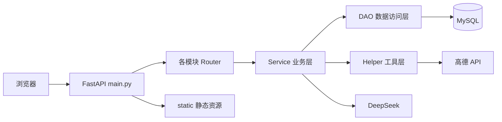
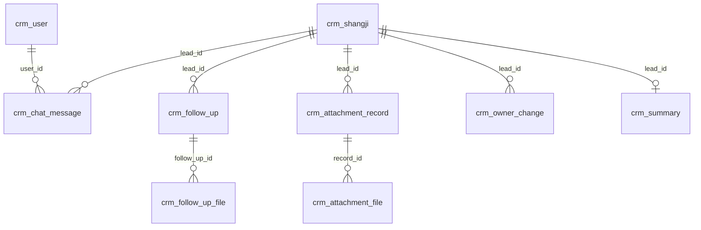

# CRM 商机系统 · 系统架构说明

## 1. 项目定位

从招标/采购公告中自动采集商机，使用 LLM 抽取结构化信息，地理编码后展示在高德地图上，并围绕每条商机提供：

- 商机详情
- 跟进记录与附件
- 负责人变更
- 招投标 / 立项资料
- 项目概况聊天（流式）
- 项目总结（标签、摘要、项目分析、经验总结）

---

## 2. 技术栈

| 层次 | 技术 |
|---|---|
| Web 框架 | FastAPI + Uvicorn |
| 会话 | Starlette `SessionMiddleware`（签名 Cookie） |
| 数据库 | MySQL + pymysql + dbutils 连接池 |
| 大模型 | LangChain + DeepSeek |
| 爬虫 | requests + BeautifulSoup |
| 地图/地理编码 | 高德 JS API 2.0 + 高德 Web 服务 API |
| 前端 | 原生 HTML / CSS / JavaScript + Bootstrap 5.3 |
| 文件存储 | 本地磁盘 `uploads/` |

---

## 3. 目录结构

```text
aicrm/
├── com/crm/
│   ├── main.py              FastAPI 入口：中间件、路由、异常处理
│   ├── common/              公共基础：配置、连接池、DAO、响应、异常、LLM
│   ├── helper/              跨模块工具：爬虫、地理编码、文件/URL/文本、项目上下文
│   ├── user/                用户注册、登录、会话、用户管理
│   ├── shangji/             商机采集、抽取、地理编码、地图点位
│   ├── source/              采集源配置（省/市 + base_domain + list_url）
│   ├── followup/            跟进记录 + 跟进附件
│   ├── attachment/          招投标/立项附件管理
│   ├── chat/                项目概况聊天（多轮 + 流式）
│   ├── owner/               负责人变更 + 变更记录
│   └── summary/             四项并行项目总结
├── static/
│   ├── common/              公共 CSS/JS、Bootstrap
│   ├── user/                登录、注册页面
│   ├── shangji/             地图页面（map.html/map.js/map.css）
│   ├── source/              商机采集菜单与弹窗
│   ├── followup/            跟进页签
│   ├── attachment/          招投标/立项页签
│   ├── chat/                概况聊天页签
│   ├── owner/               负责人页签
│   └── summary/             总结页签
├── uploads/                 运行后生成，存放跟进/附件文件
├── log/                     运行后生成，按天滚动日志
├── .env                     环境配置
├── pyproject.toml           依赖
├── ARCHITECTURE.md          本文档
└── IMPLEMENTATION.md        实现逻辑说明
```

---

## 4. 分层架构



- **API 层**：路由、参数校验、登录态依赖、统一响应。
- **Service 层**：业务流程编排、校验、LLM 调用、文件落盘、故障降级。
- **DAO 层**：只拼 SQL，统一调用 `common/basedao.py`。
- **Helper 层**：可复用能力（爬虫、地理编码、文件规则、URL、项目上下文）。
- **Common 层**：数据库连接池、全局配置、日志、统一响应、异常、全局 LLM。

---

## 5. 模块职责

| 模块 | 职责 |
|---|---|
| `main.py` | 安装 SessionMiddleware，注册全部子路由，挂载 `/static`，统一异常处理，登录/注册/首页路由 |
| `common` | `.env`、日志、MySQL 连接池、通用 CRUD、`ok/fail`、`BizException`、全局 LLM |
| `helper` | 公告爬取、高德地理编码、URL 规范、文件规则、文本裁剪、项目资料上下文 |
| `user` | 注册、登录、退出、当前用户、分页、改密、禁用/删除；PBKDF2 密码 |
| `shangji` | 调用爬虫 → LLM 批量抽取 → 地理编码 → 去重入库；地图点位查询 |
| `source` | 按“省 + 市”保存 `base_domain` / `list_url`，供采集弹窗回填 |
| `followup` | 跟进正文 + 多附件，时间轴展示 |
| `attachment` | 招投标/立项固定分类的说明 + 多附件 |
| `chat` | 项目资料作为知识库，按用户隔离历史，流式回答 |
| `owner` | 负责人下拉变更 + 变更时间轴 |
| `summary` | 标签、摘要、项目分析、经验总结四项并行生成 |

---

## 6. 数据模型



| 表 | 说明 |
|---|---|
| `crm_user` | 用户、角色、状态、密码哈希 |
| `crm_shangji` | 商机主表，含 `owner_id`、经纬度、来源 URL、去重 MD5 |
| `crm_crawl_source` | 采集源配置，`(province, city)` 唯一 |
| `crm_follow_up` | 跟进记录 |
| `crm_follow_up_file` | 跟进附件 |
| `crm_attachment_record` | 招投标/立项附件记录（分类 + 说明） |
| `crm_attachment_file` | 招投标/立项附件文件 |
| `crm_owner_change` | 负责人变更记录 |
| `crm_chat_message` | 聊天消息，按 `(lead_id, user_id)` 隔离 |
| `crm_summary` | 每个商机一份最新总结 |

SQL 脚本分别在各模块目录下，见 `IMPLEMENTATION.md` 的“数据库脚本”。

---

## 7. 认证与会话

- 登录成功后，Session 中只保存 `uid`、`username`、`role`。
- `SessionMiddleware` 对 Cookie 签名，默认 Cookie 名 `session`。
- `require_login` 每次请求重新查库：
  - 账号被禁用/删除立即生效；
  - 返回完整用户信息供权限判断。
- 首个注册用户自动成为 `admin`，其余为 `user`。
- 密码使用 PBKDF2-HMAC-SHA256（20 万次迭代 + 随机盐），校验使用常量时间比较。
- 页面路由（`/`、`/shangji/map`）未登录时 302 到 `/login`；
  业务接口未登录返回 `code=401`。

---

## 8. 统一响应与异常

业务接口统一返回：

```json
{ "code": 0, "msg": "success", "data": {} }
```

- HTTP 状态始终 200，失败信息放在 `code`。
- `BizException` → 业务错误（如 401/403/1000）。
- 参数校验失败 → `code=422`。
- 未捕获异常 → `code=500`。
- **例外**：`POST /chat/stream` 使用真实 HTTP 4xx（流式响应无法用 JSON 信封表达错误）。

---

## 9. 外部服务

| 服务 | 用途 | 关键配置 |
|---|---|---|
| 高德 Web 服务 | 地址 → 经纬度 | `GAODE_KEY_CODE`、`GAODE_URL` |
| 高德 JS API | 浏览器地图 | `AMAP_JS_KEY`、`AMAP_SECURITY_CODE` |
| DeepSeek | 商机抽取、聊天、总结 | `DEEPSEEK_API_KEY`、`DEEPSEEK_MODEL_FLASH` |

> DeepSeek 自定义网关请使用 `DEEPSEEK_API_BASE`（`langchain-deepseek` 实际读取的变量名）。
> 当前 `.env` 中的 `DEEPSEEK_BASE_URL` 不会被客户端自动读取，默认仍走官方地址。

---

## 10. 部署与运行

```bash
cd D:/workspace-pycharm/aicrm
.venv/Scripts/python.exe -m uvicorn com.crm.main:app --host 127.0.0.1 --port 8000 --reload
```

访问：

- 登录：`http://127.0.0.1:8000/login`
- 地图首页：`http://127.0.0.1:8000/`
- 接口文档：`http://127.0.0.1:8000/docs`

`/static` 由 FastAPI 直接挂载；`uploads/` 不在静态目录下，附件必须通过鉴权接口下载。

---

## 11. 关键设计取舍

1. **商机抽取使用 `json_mode`**：`deepseek-flash` 为思考模式，不支持强制 `tool_choice`。
2. **爬取同步串行**：`htmlhelper` 每条详情后随机休眠 2~10 秒，整页可能耗时数分钟。
3. **去重靠数据库唯一键**：URL 的 MD5 作为 `source_url_md5` 唯一键，`INSERT IGNORE` 跳过重复。
4. **附件本地磁盘 + 数据库元数据**：文件名为 UUID，原始文件名只存库；下载走鉴权接口。
5. **项目资料共享、聊天隔离**：聊天/总结上下文按 `lead_id` 读取；聊天历史按 `lead_id + user_id` 隔离。
6. **总结只保留最新一份**：`crm_summary` 以 `lead_id` 唯一，重新总结覆盖旧结果。
